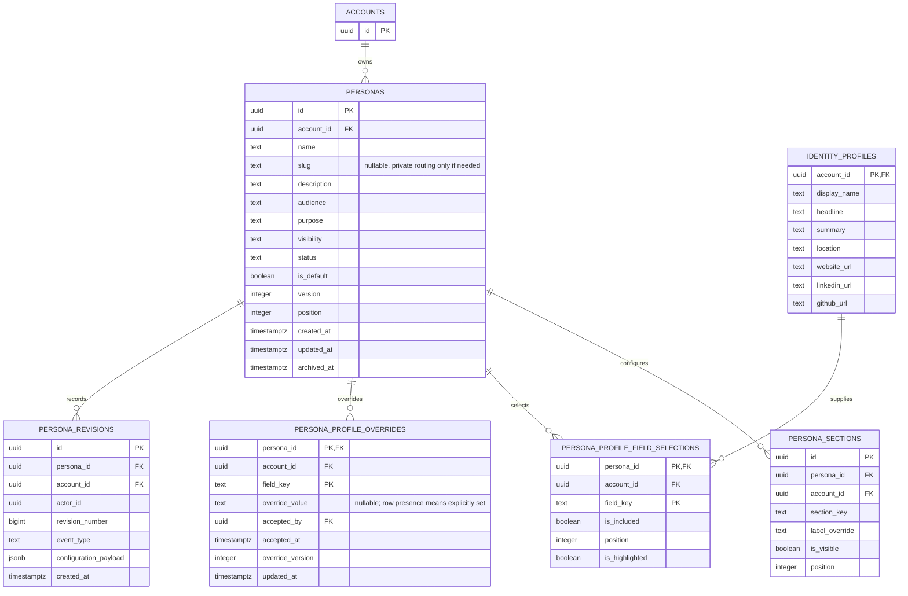

# Milestone 3A — Persona Data Model

**Status:** Proposed; no SQL executed. See [foundation decision](milestone-3a-persona-foundation.md).

## Relational boundary

The account owns Personas; a Persona owns only configuration, selection and revision rows. Canonical `identity_profiles` remains owned by `accounts` and independent of Persona lifecycle. Initial selection is field-level because the repository currently has only one profile row per account. Future many-row canonical categories must add domain-specific selection junctions with real composite foreign keys. Do not create a generic polymorphic `(source_type, source_id)` reference: PostgreSQL cannot enforce its FK or same-account ownership.

The conceptual cardinality from `identity_profiles` to field selections is one source profile to many Persona-specific field choices. A field selection row has a composite FK to `(identity_profiles.account_id)` so it cannot select another account's profile. Future record tables should expose a unique `(id, account_id)` key (or their equivalent ownership key), and selection FKs must include both values.

### Closed profile-field catalog

The only accepted identifiers are `display_name`, `headline`, `summary`, `location`, `website_url`, `linkedin_url`, and `github_url`. Each is selectable and may be overridden. The same exact `CHECK (field_key IN (...))` allowlist is applied to selection and override tables; the M3B application schema must use a matching Zod enum/constant and reject unknown identifiers before calling RPC. PostgreSQL rejects an unrecognized key with SQLSTATE `23514`, even if application validation is bypassed. No JSON property name or free-form field path selects canonical identity data.

Public projection classification is separate from private selection: `display_name`, `headline`, and `summary` may be considered by a later explicit publication allowlist; `website_url`, `linkedin_url`, and `github_url` are excluded from the initial public allowlist until a separate consent decision; `location` is sensitive and excluded by default. No field is public merely because it is selected or overridden.

## Proposed table contracts

### `public.personas`

- **Purpose:** Persona metadata and lifecycle state; not canonical identity content.
- **Primary key:** generated UUID `id`.
- **Owner FK:** `account_id NOT NULL REFERENCES public.accounts(id) ON DELETE CASCADE`; unique `(id, account_id)` supports tenant-safe child FKs.
- **Metadata:** `name NOT NULL` (trimmed, 1–100 chars), optional `slug` (1–80 normalized characters if used; no public meaning), optional `description` (≤500), `audience` (≤200), `purpose` (≤200), and `visibility TEXT NOT NULL DEFAULT 'private' CHECK (visibility='private')`. Names are user-defined; no category enum. The fixed visibility check prevents treating a private Persona row as publishable; a later publishing milestone must use projection records under AD-005.
- **Persona-only copy:** none in the parent row. Headline, summary and other profile-field alternatives are stored uniformly in `persona_profile_overrides`. An override row with a NULL value explicitly clears the canonical field; deleting that row resets to canonical resolution. This avoids duplicate representations and never mutates `identity_profiles`.
- **Lifecycle:** `status TEXT NOT NULL DEFAULT 'active' CHECK IN ('active','archived')`; `archived_at` nullable and constrained to be null exactly when active; `is_default BOOLEAN NOT NULL DEFAULT false`, constrained false while archived; `position INTEGER NOT NULL DEFAULT 0 CHECK >=0`.
- **Concurrency/audit:** `version INTEGER NOT NULL DEFAULT 1 CHECK >0`; `created_at`, `updated_at` non-null `timestamptz DEFAULT now()`.
- **Uniqueness/indexes:** unique `(id, account_id)`; case-folded unique active name per account (`lower(name)` partial index where active); optional unique `(account_id, slug)` for non-null slug; partial unique `(account_id)` where `is_default AND status='active'`; `(account_id,status,position,id)` for owner listing.
- **Delete:** account deletion cascades to Persona data consistent with account lifecycle. Persona deletion cascades to its configuration/revisions, never to canonical identity. Future Portfolio/Card references must RESTRICT deletion.
- **RLS:** SELECT/INSERT/UPDATE/DELETE to authenticated, each owner predicate uses `account_id = (SELECT auth.uid())`; insert/update WITH CHECK same. Hard delete is owner-only and app-gated on no dependencies. Anonymous/PUBLIC have no privilege.

### `public.persona_sections`

- **Purpose:** Per-Persona layout sections and order; independent of record selection. `section_key` is stable (for example `profile`, `experience`, `projects`) or a user-defined section key. Sections never automatically select new records.
- **Key/ownership:** UUID `id`; non-null `persona_id`, `account_id`; composite FK `(persona_id,account_id) → personas(id,account_id) ON DELETE CASCADE`.
- **Columns:** `section_key TEXT NOT NULL`, optional `label_override`, `is_visible BOOLEAN NOT NULL DEFAULT true`, `position INTEGER NOT NULL CHECK >=0`, timestamps.
- **Constraints/indexes:** unique `(persona_id,section_key)` and `(persona_id,position)`; index `(account_id,persona_id)`.
- **Delete/RLS:** cascade only from Persona; owner SELECT/INSERT/UPDATE/DELETE via account_id auth.uid().

### `public.persona_profile_field_selections`

- **Purpose:** Explicit field-level inclusion for the current canonical profile. An absent row or `is_included=false` means excluded. This is a closed allowlist, not a generic dynamic field store.
- **Key/ownership:** composite primary key `(persona_id,field_key)`; non-null `account_id`; FK `(persona_id,account_id) → personas(id,account_id) ON DELETE CASCADE`; FK `account_id → identity_profiles(account_id) ON DELETE CASCADE` (the canonical profile is one row per account).
- **Exact field identifiers:** `display_name`, `headline`, `summary`, `location`, `website_url`, `linkedin_url`, `github_url`. All seven may be selected for a private Persona and all seven may have a Persona override. These are the complete supported set for this initial profile schema; do not accept arbitrary property names or JSON keys.
- **Exposure classification:** `display_name`, `headline`, and `summary` are candidates for a later explicit public projection. `website_url`, `linkedin_url`, and `github_url` are private in this milestone and excluded from the initial public projection allowlist pending a separate consent decision. `location` is treated as sensitive and excluded from public projections by default. Persona selection alone never changes this classification; even candidate fields require explicit publication under AD-005.
- **Columns:** `field_key` constrained to the seven identifiers above; `is_included BOOLEAN NOT NULL DEFAULT false`; `position INTEGER NOT NULL DEFAULT 0 CHECK >=0`; `is_highlighted BOOLEAN NOT NULL DEFAULT false` and only true when included; timestamps.
- **Indexes:** PK supports Persona/field lookup; index `(account_id,persona_id,is_included,position)`.
- **Delete/RLS:** deleting canonical profile removes its field selection configuration but not Persona or other canonical data. Owner SELECT/INSERT/UPDATE/DELETE via account_id auth.uid(). Profile recreation starts with all fields excluded until explicitly selected.

### `public.persona_profile_overrides`

- **Purpose:** Explicit persona-only alternative value for an allowlisted profile field. It does not update `identity_profiles`.
- **Key/ownership:** composite primary key `(persona_id,field_key)`; same Persona composite FK and account ownership as profile selections.
- **Columns:** same closed `field_key` set; nullable `override_value TEXT`; row presence denotes an accepted active override, including intentional NULL; `accepted_by UUID NOT NULL REFERENCES accounts(id)`, constrained equal to `account_id`; `accepted_at TIMESTAMPTZ NOT NULL`; `override_version INTEGER NOT NULL DEFAULT 1 CHECK >0`; `created_at`, `updated_at`. Only a successful user-authenticated mutation RPC creates/updates this row, so it represents an explicit accepted value, not a pending AI suggestion.
- **Constraints:** field-specific length checks consistent with canonical profile limits (display name 120, headline 180, summary 2000, location 160, URLs 2048 and HTTP(S) validation). Application validation remains required.
- **Indexes:** PK plus `(account_id,persona_id)` for security/cleanup queries.
- **Delete/RLS:** Persona deletion cascades; canonical profile deletion does not delete a Persona override, but it also cascades its selection rows, so the resolver omits the field until the user explicitly selects it again after profile restoration. Owner SELECT/INSERT/UPDATE/DELETE via account_id auth.uid(), with writes additionally restricted to the approved RPC request path. Reset is deletion of the override row; future UI must distinguish “reset to My Identity” from “set empty”.

### `public.persona_revisions`

- **Purpose:** Private append-only audit of Persona configuration changes. Payload records only configuration, field keys, override changes, and provenance; it must not snapshot canonical profile or other canonical rows.
- **Key/ownership:** UUID `id`; non-null Persona/account FKs, composite FK `(persona_id,account_id) → personas(id,account_id) ON DELETE CASCADE`.
- **Columns:** `actor_id UUID NOT NULL` (must equal authenticated UID); `revision_number BIGINT NOT NULL CHECK >0`; `event_type TEXT CHECK IN ('created','updated','duplicated','archived','restored','default_changed','deleted')`; `configuration_payload JSONB NOT NULL` constrained to JSON object; `created_at TIMESTAMPTZ NOT NULL DEFAULT now()`.
- **Constraints/indexes:** unique `(persona_id,revision_number)`; `(account_id,persona_id,created_at DESC)`; check `actor_id=account_id` for current self-managed account model.
- **Delete/RLS:** history is immutable to authenticated clients: SELECT own and INSERT only within an approved mutation RPC request; no UPDATE/DELETE grant or policy. Account erasure cascades history under AD-006. Persona history is retained while the Persona is active or archived; permanent Persona deletion removes its revisions along with Persona configuration. The user-facing delete flow must warn that this removes revision history. This is user-data deletion, not regulatory audit retention.

## Typed selection pattern for future canonical records

For each many-row source introduced later, create a table such as `persona_project_selections(persona_id, account_id, project_id, section_id, position, is_highlighted, created_at)`. Require:

1. Composite FK `(persona_id,account_id) → personas(id,account_id) ON DELETE CASCADE`.
2. Composite FK `(project_id,account_id) → projects(id,account_id)` with `ON DELETE RESTRICT` (or an explicitly designed soft-archive lifecycle).
3. Unique `(persona_id,project_id)` and scoped ordering/indexes.
4. RLS owner check from auth.uid() and no anonymous/PUBLIC grants.
5. Explicit behavior for archived canonical rows and a typed override relation for fields that may be rewritten. New canonical rows are always excluded until selected; no section-wide auto-include flag is provided.

Repeat per canonical type (experience, education, skill, project, achievement, certification, publication, article/thought, timeline item). Do not create these tables until their canonical tables and lifecycle rules have been designed. A section can group the typed selected row; section IDs must also be constrained to the same Persona/account.

## Data lifecycle and concurrency

- All Persona writes use the authenticated Supabase client after server `auth.getUser()`; the UID used in filters comes from the verified user. RLS is the enforcement boundary.
- Create and duplicate operations set `status=active`, `is_default=false`, `visibility=private`; duplicate copies only configuration, never source values.
- Archived Personas remain available to their owner for read-only review/preview; edits, default selection and future publication require restore.
- Set default is one `persona_set_default` authenticated PostgREST RPC transaction: take a transaction advisory lock scoped to `auth.uid()`, check the target Persona is active, clear the previous default, set the target, and append revisions for both changed Personas. A partial unique index remains the final invariant. Concurrent calls for one account serialize; different accounts use different lock keys. Accounts are not required to have a default. Archive clears it; restore is non-default; delete leaves no default and does not auto-promote another Persona.
- Archive is an atomic status + `archived_at` + `is_default=false` update. Restore sets active and clears `archived_at`, leaving default false.
- Every mutation is a single `VOLATILE SECURITY INVOKER` PostgREST RPC request with an expected version (except creation/default switch where the function performs the necessary locking). The function derives account and actor only from `auth.uid()`, updates configuration and inserts a revision in one PostgreSQL transaction. An exception or revision insert failure rolls back all changes. Stale versions return SQLSTATE `40001` and a reload/reapply path.
- Permanent deletion is available only after archive and requires the expected current version. Child configuration and revision history are removed in the same transaction. Future Portfolio/Card FK references use `ON DELETE RESTRICT`; a dependency violation aborts the delete and preserves all Persona data. Detach or delete the dependent output first. No auto-promotion occurs if the deleted Persona was default.
- Canonical reads are live. Overrides remain explicitly accepted user-authored values and are not silently replaced when canonical values change. If a selected canonical field is NULL, return no value unless an override row exists. The current profile-selection FK cascades the selection row if the profile row is deleted; without a selection, omit the field even if an override remains. Restoring/recreating a profile does not reselect fields automatically. Future selected source records should use `ON DELETE RESTRICT` and soft archive; hard deletion requires explicit deselection in the same reviewed operation.
- Account deletion cascades Persona data as part of AD-006. Persona deletion cannot cascade toward canonical tables.

## Deterministic effective-value algorithm

Resolve only selected fields. For each selected `field_key`, in order:

1. If an accepted override row exists, use its value. `override_value IS NULL` is an explicit clear and resolves to omission; it never falls through to canonical data.
2. Otherwise read the current canonical `identity_profiles` value. A non-NULL value is returned as canonical. NULL is omitted.
3. If the profile or field is missing/deleted, omit it and report an owner-only unavailable-source state; never resurrect an old copied value.
4. If selection is absent or false, omit the field regardless of any override row.
5. Reset removes the override row; the next resolution uses the current canonical value (or omission if missing/NULL).

Examples: (a) canonical headline “Engineer”, no override → “Engineer”; canonical changes to “Founder” → next resolution is “Founder”. (b) canonical “Engineer”, accepted override “Founder” → “Founder”; canonical changes to “CEO” → still “Founder”. (c) override row with NULL → omit headline; do not reveal canonical “Engineer”. (d) delete/reset override → latest canonical “CEO”. (e) field deselected → omit even while an override remains; reselecting returns to the accepted override unless the user reset it. A canonical update never creates or changes an override.

## Atomic mutation and revision contract

PostgREST executes each API request in a transaction; a volatile RPC invoked with POST can perform writes, and a raised error rolls back the request. Each approved mutation is therefore one RPC call containing the configuration write and revision insert.

The proposed RLS write gate checks both `auth.uid()` ownership and PostgREST's transaction-scoped `request.method='POST'` plus an exact `request.path` allowlist for `rpc/persona_*` mutation functions. Direct table REST writes have a different path and fail RLS even though `authenticated` needs table DML grants for SECURITY INVOKER functions. Only the named mutation functions receive EXECUTE for `authenticated`; default PUBLIC, anon and service_role execution is revoked in the same transaction. A read-only SECURITY INVOKER context helper is used by RLS; it is not itself an allowed mutation path. The authenticated user cannot supply PostgREST's actual request path through row data or JWT claims.

The set is closed: create, metadata update, profile-field selection/override, section upsert/delete, default switch, archive/restore, duplicate, permanent delete. Every function omits an account-id argument, obtains actor/owner from `auth.uid()`, validates field keys against the exact allowlist, locks and checks the version, and inserts revision rows before returning. Revision INSERT RLS requires the same owner, actor=auth.uid(), and approved request context. Revision UPDATE/DELETE have no authenticated grants/policies. A failed check, constraint, revision insert, or future dependency FK aborts the whole request.

This is a PostgREST-specific boundary and must be confirmed against the deployed Supabase/PostgREST behavior before execution. Official PostgREST documentation describes per-request transactions and transaction-scoped request settings; PostgreSQL documents SECURITY INVOKER as executing with caller privileges and notes that function EXECUTE defaults to PUBLIC unless revoked. References: [PostgREST transactions](https://docs.postgrest.org/en/stable/references/transactions.html), [PostgREST request settings](https://docs.postgrest.org/en/v11/references/transactions.html), [PostgreSQL CREATE FUNCTION](https://www.postgresql.org/docs/current/sql-createfunction.html), [PostgreSQL constraints](https://www.postgresql.org/docs/17/ddl-constraints.html). No transaction-local Drizzle identity claim or custom role is used. `auth.uid()` remains the sole authorization identity.

No SECURITY DEFINER function, service-role access, direct PostgreSQL runtime connection or custom database role is proposed. If the actual Supabase endpoint does not populate `request.path`/`request.method` as documented, stop before execution and design another non-bypassable policy rather than weakening RLS.
