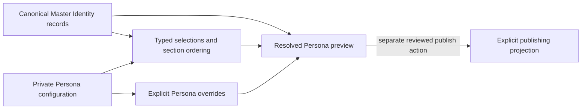
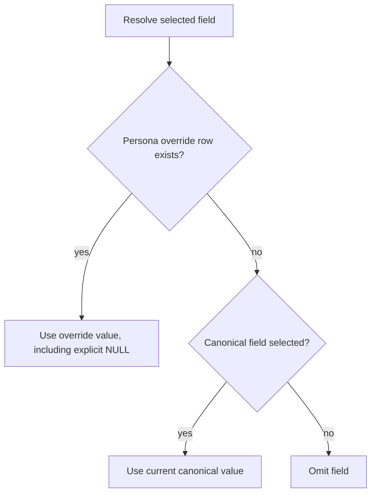
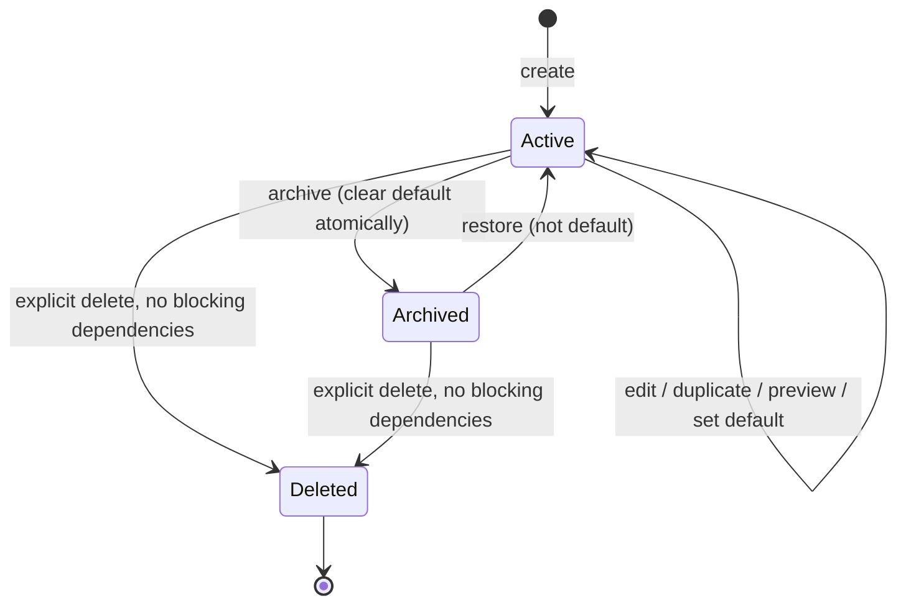
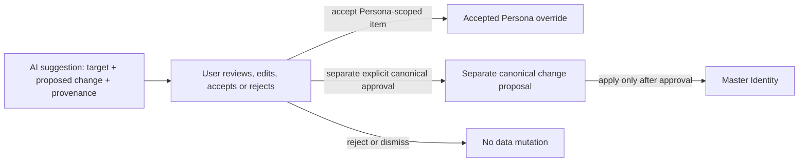

# Milestone 3A — Persona Foundation

**Status:** Design proposal; pending review. No application implementation or database change is authorized by this document.

## Executive decision

Model a Persona as private, account-owned configuration over the canonical Master Identity. Use relational references and typed selection relations, with explicit persona-specific overrides. Do not copy canonical identity records into a Persona. This follows AD-002 and AD-003 while allowing each presentation to emphasize and phrase shared information differently.

The current repository has only `accounts` and the one-to-one `identity_profiles` canonical record. Accordingly, the proposed first schema supports persona metadata, profile-field selection and profile-field overrides. Experience, education, skill, project, achievement, publication and article selections must use typed join tables introduced alongside their canonical tables; no unconstrained `(record_type, record_id)` reference is proposed. This avoids inventing absent tables and preserves real foreign-key and tenant guarantees.

Personas remain private. Selection is not publication. Any future public output must follow AD-005: explicit preview and publication into an allowlisted, versioned projection; public consumers never read these private tables directly.

## Repository and approved architecture reviewed

- [Architecture decisions](architecture-decisions.md), especially AD-001 through AD-007.
- [Implementation blueprint](implementation-blueprint.md), especially its relational model, security, lifecycle and publishing sections.
- [Milestone 2A verification](milestone-2a-verification.md), [Milestone 2C verification](milestone-2c-rls-isolation-verification.md), identity DDL, SQL workflow and execution tracker.
- `src/db/schema/index.ts`, the authenticated Supabase server client, profile repository/service, and the existing unit/hosted test structure.
- [Design system](design-system.md), [project structure](project-structure.md).

The deployed identity foundation has two private tables, `accounts` and `identity_profiles`, with RLS enabled and forced and `auth.uid()` owner policies. Milestone 2C records successful two-user isolation through authenticated Supabase Auth JWTs and PostgREST. `postgres` owns those tables and bypasses RLS; it remains a DDL-only identity. Application data requests use the verified authenticated Supabase server client. Drizzle is for schema definitions and locally authored SQL, not user-scoped runtime access. AD-004 had a stale statement that two-user verification was pending; its verification-status text is corrected to point to Milestone 2C, without changing the approved decision. The old blueprint's original repository assessment is historical and predates the present implementation; its product and security decisions remain consistent.

## Decisions and alternatives

| Area                             | Options considered                                                             | Recommendation and trade-off                                                                                                                                                                                                                                                                                                    |
| -------------------------------- | ------------------------------------------------------------------------------ | ------------------------------------------------------------------------------------------------------------------------------------------------------------------------------------------------------------------------------------------------------------------------------------------------------------------------------- |
| Canonical content representation | Reference-only; references plus overrides; full snapshot                       | **References plus explicit overrides.** Reference-only cannot express a distinct audience voice. Snapshots duplicate stale canonical content and risk becoming a second source of truth. Overrides add resolution and audit work but preserve canonical integrity.                                                              |
| Selection storage                | JSON document; generic type/id pair; typed relational joins                    | **Typed relational joins per canonical domain.** JSON and polymorphic IDs cannot provide ordinary FK ownership integrity. Add each typed selection table with its canonical table. Initial DDL handles the existing profile only.                                                                                               |
| Presentation configuration       | Copy rows; free-form JSON; relational section and selection rows               | **Relational section/selection rows.** JSONB is reserved for bounded, versioned revision payloads, not identity records or ownership links.                                                                                                                                                                                     |
| Persona types                    | Fixed enum; user-created labels                                                | **User-created metadata.** Name, audience and purpose are text, not a hard-coded category enum. Examples such as Professional and Academic are suggestions only.                                                                                                                                                                |
| Default                          | Require exactly one at all times; optional default; infer from first row       | **Zero or one active default.** Do not auto-create a Persona or force a default during onboarding. A partial unique index guarantees at most one; an authenticated transaction/RPC changes it atomically. Archive clears its default in the same write.                                                                         |
| Visibility                       | Persona-level public switch; always private until publication                  | **Private only in this milestone.** The publication service later consumes a Persona and creates an explicit public projection under AD-005.                                                                                                                                                                                    |
| Deletion                         | Cascade into canonical data; permanent retention; archive then explicit delete | **Archive first; explicit hard delete only when dependencies permit.** Child configuration/revisions can cascade from Persona deletion; canonical rows must never be cascaded from Persona. Future Portfolio/Card foreign keys should RESTRICT Persona deletion while referenced.                                               |
| History                          | Mutable current state only; copied canonical snapshots; audit/config revisions | **Append-only Persona configuration revision events.** Record configuration and override changes, not copied canonical values. This is an application audit trail, not tamper-proof against database owners. The mutating implementation must write change and revision atomically; see open implementation prerequisite below. |
| Sync                             | Copy canonical values on change; pin snapshots; resolve references live        | **Resolve current canonical value on read unless an explicit override exists.** New records are excluded until selected. Archive hides a source from preview; restore can make it available again. A hard delete must be explicitly handled and cannot silently erase a selection.                                              |
| Concurrency                      | Last writer wins; optimistic version; lock every edit                          | **Optimistic version column.** Mutations include expected version and increment it; conflict returns a retry/reload result. Default switching uses a transaction and unique index.                                                                                                                                              |
| Future consumers                 | Each consumer reimplements selection; Persona as shared input                  | **Portfolio, Digital Cards, CV Studio and previews consume one Persona resolver contract.** Consumers may add their own layout/configuration, but do not duplicate the Persona's inclusion and override rules.                                                                                                                  |
| AI                               | Directly apply suggestions; suggestions as approved proposals                  | **Separate suggestion, review, accept/reject flow.** AI cannot write canonical or Persona tables. Acceptance is an explicit authenticated action and is audited with provenance.                                                                                                                                                |

## Master Identity → Persona

Canonical data is stored once. A Persona stores references, inclusion decisions, ordering/highlight configuration and only the values intentionally rewritten for that presentation. A Persona never writes through to Master Identity.

## Proposed initial data model

The detailed table contract and ER diagram are in [Persona data model](milestone-3a-persona-data-model.md). The proposed objects are:

1. `public.personas` — owner, user-authored metadata, active/archive state, default flag and optimistic version.
2. `public.persona_sections` — section labels, visibility and order; newly added content defaults excluded.
3. `public.persona_profile_field_selections` — allowlisted `identity_profiles` field inclusion for the existing one-per-account profile.
4. `public.persona_profile_overrides` — explicitly present override rows; a row with NULL value means the user intentionally clears the canonical value. Deleting the row resets to canonical resolution.
5. `public.persona_revisions` — append-only configuration-change history, with no canonical values copied.

The profile-field catalog is closed to seven identifiers, enforced by SQL CHECK constraints and a matching application enum in M3B. All seven are selectable and overridable privately; public projection eligibility is narrower and requires a later explicit publication decision. Unknown field keys fail both application validation and database constraints.

Every Persona and child row carries `account_id`. Composite foreign keys tie child rows to the same owner's Persona. RLS then checks `account_id = (SELECT auth.uid())`; the FK prevents a child from pairing its Persona ID with a different account ID. Canonical references in future typed selection tables must use both record ID and account ID in a composite FK.

The identity profile field allowlist is `display_name`, `headline`, `summary`, `location`, `website_url`, `linkedin_url`, and `github_url`. Sensitive contact fields added later are excluded by default and must be explicitly evaluated before adding to an allowlist. Each future canonical category receives its own typed join table and field-specific override model in the milestone that creates that canonical table.

## Effective value and synchronization

Selection and override are independent. An excluded field is omitted even if a stale override row exists; saving the configuration should remove or retain it as an explicitly hidden override according to an implementation decision, but it must never appear accidentally. Reset deletes the override row and resumes canonical resolution. An override row records whether a value is intentionally set, even when the intended value is NULL.

When canonical values change, Personas referencing them resolve the new value immediately where no override exists. No value is copied into the override store. Added canonical records are not selected automatically. Archived canonical records are excluded from preview with a recoverable “source archived” state; restoring the canonical record makes the selection resolvable again. Canonical hard deletion must be blocked while selected, or require an explicit transaction that removes the selection and records the change; it must not silently cascade through Persona history. Notify the owner when a selected source is archived, removed, or materially changed if a later change-review/version comparison is implemented. Notifications are not required for ordinary live resolution.

## Lifecycle

Creation begins as active, private and non-default. There is no mandatory Persona count and no arbitrary count cap. Only an active Persona may be default. Archiving clears default in the same transaction. Restoring does not silently restore default. Duplicating copies metadata, sections, selections and overrides into a new Persona and records a revision; it does not copy canonical data or default status. Archive is reversible; delete is not. Hard delete removes only the Persona's own configuration and history, subject to future consumer dependencies and account-retention rules.

## RLS and access boundary

The table-by-table policy contract and expected SQLSTATE/result semantics are in [Persona security](milestone-3a-persona-security.md). All proposed tables enable and force RLS. Authenticated users receive only operations needed by the Persona UI; anonymous and PUBLIC receive none. User ownership comes from `auth.uid()`, never an account ID trusted from browser input. SQL execution as `postgres` is not enforcement evidence because it bypasses RLS. No hosted tests are part of this design milestone.

Configuration writes and their append-only revision records use one allowlisted, `VOLATILE SECURITY INVOKER` PostgREST RPC request. The caller is still `authenticated`; RLS checks ownership and verifies the transaction-scoped PostgREST request method/path. Direct table REST mutations fail the RLS path gate. The RPC derives owner/actor from `auth.uid()`, validates expected versions and field identifiers, performs all related writes, and inserts a revision before returning. PostgreSQL/PostgREST transaction rollback makes the change and audit entry all-or-nothing. No SECURITY DEFINER, direct PostgreSQL runtime connection, service-role bypass, custom role or Drizzle identity claim is used. The guard depends on the hosted PostgREST request settings and must be verified before DDL execution.

Accounts may have zero or one active default Persona. A partial unique index enforces “at most one”; an account-scoped advisory transaction lock serializes `persona_set_default` requests. Archive clears default, restore remains non-default, and deleting a default leaves none. Every-account-must-have-a-default is not a product requirement.

## UX and AI boundaries

Screen specifications and user journeys are in [Persona UX](milestone-3a-persona-ux.md). The approved editorial-workspace style applies: warm ivory canvas, charcoal navigation, serif headings, restrained warm accents, quiet borders and generous whitespace. Personas are described by the user's purpose and audience, not treated as resume templates.

AI suggestion lifecycle and the security test matrix are in [Persona test plan](milestone-3a-persona-test-plan.md). AI output remains a separate suggestion with provenance and target scope. Accepting a Persona suggestion changes only that Persona override; changing canonical identity requires a separate, explicit canonical-change approval.

Suggestion records, model metadata, retention and execution are outside this milestone. Future suggestion rows must carry target scope (`persona` or `master_identity`), source/provenance, proposed payload, status, reviewer/approval timestamp and expiry/retention policy; never use the suggestion table as an accepted value store.

## Implementation prerequisites and unresolved decisions

The following do not block this design, but must be settled or implemented before a safe M3B write path:

- The initial schema gives the profile singleton typed field selection. Each future canonical entity must ship with a typed selection FK and explicit archive/delete behavior; do not substitute a polymorphic ID table.
- M3B must implement the named mutation RPC contract from the security document, with the exact signatures and field allowlist in SQL file 005. Confirm Supabase's deployed PostgREST `request.path` and `request.method` settings through a separately approved hosted test before relying on the RLS write gate. If they differ from documented behavior, stop rather than weaken RLS.
- Revision history is retained while active or archived, and purged with permanent Persona deletion; account deletion purges all Persona data under AD-006. Keep revision payloads private because they may contain previously accepted persona-authored text.
- Confirm field-level profile exposure rules when additional canonical fields are introduced. Current profile selection allowlist is intentionally narrow and excludes unmodeled fields.
- Future Portfolio/Card FK deletion behavior should be `RESTRICT`; dependent-object archival/migration behavior is a later design task.

No product feature, app source code, dependency, database object, RLS policy, or hosted-test result is changed or created by this design. Proposed SQL is pending review and manual execution only.
